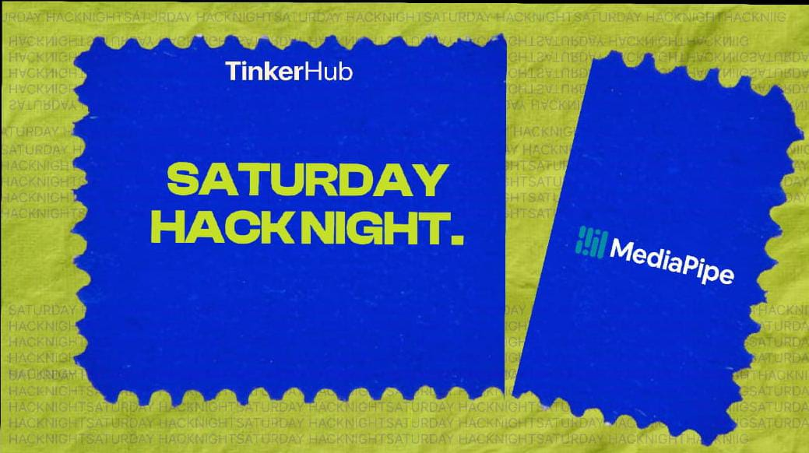

# 🌫️ FogMirror — Interactive Hand-Controlled Fog Interface



**FogMirror** is an interactive computer vision project that explores a touchless way of interacting with a virtual fog-covered surface using real-time hand tracking.

Using a webcam and Google's MediaPipe Hand Landmarker, FogMirror detects hand movements and tracks the index fingertip, allowing users to interact with the virtual surface through natural gestures.

## 💡 What's the Idea?

Imagine a fog-covered mirror where you don't need to touch the glass to interact with it.

FogMirror brings this concept into a digital environment. By combining computer vision, hand landmark detection, and real-time image processing, the project aims to simulate the experience of clearing fog using your finger.

The goal is to create an immersive, responsive, and interactive touchless interface.

## 🌐 Check It Out!

- **Live Website:** N/A — Desktop application
- **GitHub Repository:** [https://github.com/AgentRed77/SHN-MEDIAPIPE.git]
- **Original Project Inspiration:** SHNN-MEDIAPIPE

## 🛠️ What Did You Use?

| Technology | Purpose |
|---|---|
| Python 3.13.5 | Core programming language |
| OpenCV | Camera capture and image processing |
| MediaPipe 1.2.2 | Real-time hand landmark detection |
| NumPy | Matrix operations and mask processing |
| Git & GitHub | Version control |

## 👩‍💻 The Human Behind It

- **Medhajith M** — [@AgentRed77](https://github.com/AgentRed77)

Built through experimentation, problem-solving, and continuous development.

## ⚙️ Hardware Corner

- Laptop / PC
- Built-in or external USB webcam
- Standard keyboard for application controls

## ✨ Cool Things It Does

- **Real-Time Hand Tracking:** Detects and tracks hands using MediaPipe.
- **21 Hand Landmarks:** Identifies key points across the hand.
- **Index Fingertip Detection:** Highlights Landmark 8 for precise interaction.
- **Dual Coordinate Tracking:** Displays both pixel coordinates and normalized coordinates.
- **Interactive Canvas Engine:** Uses continuous stroke interpolation and feathered alpha masks for smooth interaction.
- **Real-Time Processing:** Designed for responsive camera-based interaction.
- **Touchless Interaction:** Explores gesture-based control without physical contact.

## 🏗️ Development Progress

FogMirror is being developed incrementally through independent milestones.

- [x] Phase 1 — Environment Setup
- [x] Phase 2 — Camera Capture and Processing
- [x] Phase 3 — Real-Time Hand Tracking
- [x] Phase 4.1 — Configuration and Mask Canvas Engine
- [ ] Phase 4.2 — Photorealistic Fog Generation and Blending
- [ ] Phase 4.3 — Automated Fog Engine Verification
- [ ] Phase 4.4 — Main Loop Integration

*Development status will be updated as new milestones are completed and tested.*

## 📸 Show Us What You Built!

Screenshots, camera demonstrations, and project progress will be added here as development continues.

## 🚀 Running the Project

Clone the repository:

```bash
git clone https://github.com/AgentRed77/SHN-MEDIAPIPE.git
cd FogMirror
```

Create and activate a virtual environment:

```bash
python -m venv .venv
.venv\Scripts\activate
```

Install dependencies:

```bash
pip install -r requirements.txt
```

Run the application:

```bash
python main.py
```

**Controls:**
- Raise your hand to activate tracking.
- Move your index finger to interact with the canvas.
- Press `C` to clear/reset the surface.
- Press `Q` or `ESC` to exit.

## 💜 Acknowledgements

Inspired by the collaborative spirit of Saturday Hack Night and built with curiosity, experimentation, and a passion for computer vision.

**Built with curiosity. Driven by innovation. 💜**